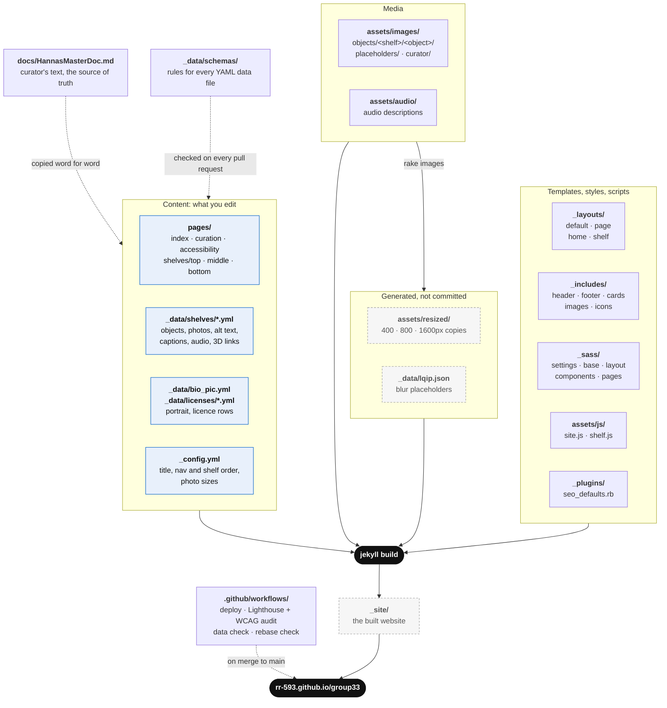

# Group 33 exhibition sandbox

Group 33 Jekyll site. Public repo. Push to `main` → auto build + publish →
<https://rr-593.github.io/group33/>. Public at once, so check
before merge.

## Run it on your computer

The quickest way to see the site. You need [Ruby 4.0.6](https://www.ruby-lang.org/en/downloads/)
(the version in `.ruby-version`; `rbenv install 4.0.6` if you use rbenv) and nothing else.

```text
bundle install              # first time only, and after Gemfile.lock changes
bundle exec jekyll serve    # builds the site and rebuilds it whenever you save a file
```

Open <http://127.0.0.1:4000/group33/> (the slash at the end matters). Edits to pages,
styles and data show when you refresh; after editing `_config.yml`, stop with Ctrl+C
and run the second command again.

This skips the photo resizing script, so photos show at full size: everything works,
pages just load more slowly. To see the site exactly as visitors get it, use
`bundle exec rake serve` instead (needs ImageMagick, see [Photo resizing](#photo-resizing)).

## Repo map



Blue boxes are what you edit to change the exhibition; grey dashed boxes are made for
you and are gitignored. Other files at the top level: `Rakefile` (project tasks),
`Gemfile`/`Gemfile.lock` (Ruby gems, versions locked), `_scripts/` (audit tools used by
the Lighthouse workflow), `NOTICE.md` and `LICENSE` (licences), `CITATION.cff` (how to
credit contributors: use the names people give, never guesses from accounts).

## Photo resizing

Original photos are large (often 1–4 MB). Sending them to every phone would make the
site slow, so `bundle exec rake images` (in `Rakefile`) makes smaller copies:

- **Resized copies:** every JPEG under `assets/images/` gets a copy at each width in
  `image_sizes` in `_config.yml` (now 400, 800 and 1600px), saved under
  `assets/resized/` with the same folder structure. Browsers pick the smallest copy
  that looks sharp on their screen.
- **Blur placeholders:** a 20px-wide version of each photo, stored in `_data/lqip.json`
  and written straight into the page, so a blurry preview shows while the real photo
  downloads.
- **Originals are never changed.** Both outputs are gitignored and rebuilt by GitHub
  when the site deploys, so never commit them.
- **Only what changed is redone.** A copy is remade when its original is newer, so a
  second run takes seconds.

You need [ImageMagick](https://imagemagick.org) for it: `brew install imagemagick`
(macOS), `winget install ImageMagick.ImageMagick` (Windows) or
`sudo apt install imagemagick` (Linux). `bundle exec rake serve` and
`bundle exec rake build` run it for you first.

On GitHub, the deploy and audit workflows keep the copies in the Actions cache and only
run the script again when a photo, the `Rakefile` or `_config.yml` changes.

Troubleshooting:

- **A replaced photo still shows the old picture:** the copied file kept its old date.
  Delete its files in `assets/resized/` and run `bundle exec rake images` again.
- **`ImageMagick not found`:** install it (above), then open a new terminal.
- **`magick: ParseError missing >`:** harmless. The museum photos carry broken
  embedded metadata, which the copies leave out.

## Update descriptions on the GitHub website

Use this to change alt text, captions, audio description transcripts or object details
without installing anything. Every change goes through a pull request, so it is
checked before it goes live.

Where each piece of text lives:

| On the site | File | Field |
|---|---|---|
| Object name, accession number, material, details | `_data/shelves/<shelf>.yml` | `metaDescription` |
| What a screen reader says for a photo | `_data/shelves/<shelf>.yml` | `altText` under `images` |
| Caption under a photo | `_data/shelves/<shelf>.yml` | `caption` under `images` |
| Audio description text (key T) | `_data/shelves/<shelf>.yml` | `transcript` under `audioDescription` |
| Shelf introduction and header photo | `_data/shelves/<shelf>.yml` | `description`, `image` at the top |
| Home page display photo | `pages/index.md` | `display_image` at the top |
| Curator portrait | `_data/bio_pic.yml` | `altText`, `caption` |

1. **Get the wording right first.** Exhibition text comes from the curator. Check it
   matches `docs/HannasMasterDoc.md`, or update that file in the same pull request
   (step 7).
2. **Open the file.** On the repository page, press <kbd>T</kbd> (or click
   **Go to file**) and type the file name, for example `middle.yml`.
3. **Find the object.** Press <kbd>Ctrl</kbd>+<kbd>F</kbd> (<kbd>Cmd</kbd>+<kbd>F</kbd>
   on a Mac) and search for its accession number, for example `MU3735`.
4. **Edit.** Click the pencil icon (**Edit this file**) at the top right of the file.
   Change only the text after the field name, for example:

   ```yaml
       images:
         - url: assets/images/objects/middle/seated-statuette/5 Seated Statuette_MU3735_front_Image1.jpg
           altText: Object 5. A small ceramic figure seated on a black base.
           caption: 5. Seated statuette, MU3735, front view © Gale History Museum
   ```

   Keep these YAML rules or the check in step 8 will fail:
   - Keep the spaces at the start of the line exactly as they are (spaces, never tabs).
   - If the text contains a colon followed by a space (`: `), or starts with a quote,
     `#`, `[` or `{`, wrap the whole text in double quotes:
     `details: "Greek: c. 5th century BCE"`. Inside double quotes, write a double quote
     as `\"`.
   - Text that is only a number, a date or a word like `yes`/`no` also needs quotes:
     `accNo: "1985053"`.
   - Never leave a field empty. If the text isn't written yet, put `TBC`.
5. **Check your change.** Click the **Preview** tab to see the lines you changed in
   green and red.
6. **Save to a new branch.** Click **Commit changes…**, write a short message such as
   `Fix alt text for seated statuette`, choose **Create a new branch for this commit
   and start a pull request**, and click **Propose changes**, then
   **Create pull request**.
7. **More files in the same change (optional).** At the top of the repository, switch
   the branch menu from `main` to your new branch, open the next file, edit it, and
   choose **Commit directly to the** your-branch **branch**. It joins the same
   pull request.
8. **Wait for the checks.** At the bottom of the pull request:
   - **Validate data** checks the YAML. If it fails, click **Details**: the error names
     the field, for example `$.artifacts[3].images[0].altText: '' should be non-empty`.
     Fix it with the pencil on your branch (step 7).
   - **Lighthouse** posts a comment with accessibility and performance results. Text
     edits rarely change these.
   - **Rebase check** fails if `main` moved on since you started. Click the arrow next
     to **Update branch** and choose **Update with rebase**.
9. **Ask for a review.** Add a teammate under **Reviewers**. Merging to `main`
   publishes the site.
10. **Check the live site.** About 2–3 minutes after merging, the change is on
    <https://rr-593.github.io/group33/>. Refresh the page (hard refresh if it looks
    old: <kbd>Ctrl</kbd>+<kbd>Shift</kbd>+<kbd>R</kbd>, or
    <kbd>Cmd</kbd>+<kbd>Shift</kbd>+<kbd>R</kbd> on a Mac).

Adding or replacing a photo or audio file works the same way: open its folder under
`assets/`, click **Add file** → **Upload files**, then add or update its entry in the
shelf file. Record who owns it and how it may be used in the caption first (see
[Workflows](#workflows)).

## Gallery tablet mode

For the tablet beside the display case. In this mode, when nobody has touched the tablet
for 2 minutes, a message asks "Are you still there?" and counts down 20 seconds. Tapping
**I'm still here** keeps the page; otherwise the site goes back to the home page, at the
top, with zoom reset, ready for the next visitor. A playing audio description counts as
someone using it.

It is off on every device until you turn it on, so visitors can't switch it on by
accident:

1. On the tablet, open <https://rr-593.github.io/group33/?kiosk=on>.
2. A message asks whether to turn on gallery tablet mode. Tap **OK**.
3. The address goes back to normal and the mode stays on for that browser, even after
   restarting it. Other devices are not affected.

To turn it off, open <https://rr-593.github.io/group33/?kiosk=off> on that tablet.
Clearing the browser's website data also turns it off.

Change the timings under `kiosk:` in `_config.yml` (`idle_seconds`, `warning_seconds`).
Keep the warning at 20 seconds or more, so people have time to respond (WCAG 2.2.1). The
code is `assets/js/kiosk.js`.

Touches inside the 3D model viewer happen in Nira's own frame, which the site can't
see, so someone turning a model for 2 minutes gets the warning; one tap keeps the page.

### Setting up the iPad

- Use a normal Safari tab, not a Private tab: a Private tab forgets the setting when it
  is closed.
- Turn the mode on in the same browser visitors will use. An icon added with **Add to
  Home Screen** keeps its own separate settings, so use Safari itself.
- **Settings > Display & Brightness > Auto-Lock > Never**, and keep the iPad on charge,
  so the screen doesn't lock between visitors.
- **Settings > Accessibility > Guided Access**: turn it on, open the site in Safari, then
  triple-click the top (or Home) button and tap **Start**. Visitors then can't leave
  Safari. Triple-click and enter the passcode to stop it.
- Safari can clear a site's saved settings after about a week without use. After a long
  closure, open `?kiosk=on` again to be safe (if it's already on, nothing is asked).

## Master doc layout

`docs/HannasMasterDoc.md`. Exhibition text copied word for word from curator. `TBC` = curator not supplied yet.

1. **Still to do** — table of missing bits per page/object.
2. **Things to check** — mistakes spotted in source. Not fixed. Ask curator.
3. **Home page** — display image, overview, Auslan, acknowledgements.
4. **About page** — visitor info, curator bio, funding, thanks, website team.
5. **Objects at a glance** — one row per object: shelf, acc. no., material, date, image count, 3D link.
6. **Top / Middle / Bottom shelf** — per object: field table (acc. no., material, dimensions, details, 3D, audio file), overview, audio description, image table (file, caption, alt text).

## Data files

### Shelf (`_data/shelves/<shelf>.yml`)

```yaml
title: Top shelf
description: text                 # "TBC" → hidden on page
image: { url, altText, caption }  # shelf hero
artifacts:                        # min 1
  - metaDescription:
      name: Pelike
      accNo: MU4759
      material: Ceramic
      dimension: [344, 200, 0]    # [H, W, D] mm. Exactly 3. Missing → 0, page shows "n/a"
      details: text
    images:                       # min 1. First = card cover
      - url: assets/images/objects/top/pelike/1 Pelike_MU4759_front_Image1.jpg
        altText: text
        caption: text © credit
    obj3D: { url, altText }       # optional. Present → "View in 3D" button + D key
    audioDescription:
      url: assets/audio/1. Pelike MU4759.m4a   # "TBC" → no player, transcript still shows
      transcript: text
```

### Licence (`_data/licenses/<name>.yml`)

One file = one row of the Curation page licence tables. Rows sorted by `name`.

```yaml
name: Swiper 11.2.10
use: image carousels              # optional, shown in brackets
used_for: website                 # website = sent to visitors; building = team tools only
licence:
  name: MIT License
  url: https://github.com/nolimits4web/swiper/blob/master/LICENSE
  note: text                      # optional, shown in brackets
author:
  name: Vladimir Kharlampidi
  url: https://swiperjs.com
```

Rules (`_data/schemas/*.schema.yml`): no extra keys. Every text field non-empty. Unknown → `TBC`, never empty.
Paths relative to repo root, no leading slash. Layout adds `/group33`.
Text containing `: ` (colon space) or starting with a quote → wrap the whole value in `"double quotes"`.

## Workflows

Rights first. No third-party photo, audio, video or 3D model until owner,
permitted use + required credit recorded: credit in caption, terms in
`NOTICE.md` or beside asset.

### Change object text

1. Curator updates master doc.
2. Copy change into `docs/HannasMasterDoc.md`. Word for word.
3. Same change into matching `_data/shelves/<shelf>.yml`.
4. Test local (below). Commit.

### Add object photo

1. Drop `.jpg` in `assets/images/objects/<shelf>/<object>/`. Stand-in photo → `assets/images/placeholders/`.
2. Add `{ url, altText, caption }` to object `images` in the shelf YAML. `altText` = what photo shows, for its purpose here. Caption carries © credit, e.g. `© Gale History Museum`.
3. Run `bundle exec rake images` (or restart `rake serve`) to make its resized copies. Without them it shows full size locally.

Replace photo = overwrite same file name. Rename or move photo → update `url` in shelf
YAML (home photo: `display_image` in `pages/index.md`) too, else broken image. More on
the copies: [Photo resizing](#photo-resizing).

`docs/` never published. Keep drafts + raw docs there, not repo root: root
files without front matter get copied to live site as-is.

### Add audio

1. Drop file in `assets/audio/`.
2. Set object `audioDescription.url` to path. Keep `transcript` filled.

### Add 3D model

Add `obj3D: { url: <nira link>, altText: <object name> }` to object. Button appears by itself.

### Git

- Branch per change. PR into `main`.
- Rebase on `main`, no merge commits. `git fetch origin && git rebase origin/main && git push --force-with-lease`.
- Merge to `main` = live. Check before merge.

### CI (`.github/workflows/`)

| Workflow | When | Does | Blocks? |
|---|---|---|---|
| `pages.yml` | push `main` | resize photos, build, deploy Pages | is deploy |
| `validate-data.yml` | `_data/**` change | schema check shelf + licence YAML | red = fix |
| `rebase-check.yml` | PR | branch behind `main` or has merges → fail | red = rebase |
| `lighthouse.yml` | PR + push | builds once, then every page, desktop + mobile in parallel: 100 accessibility, best practices, SEO; performance ≥95 desktop, ≥80 mobile. Score table + audits that cost points (`_scripts/lighthouse-report.mjs`). axe-core WCAG 2.2 A/AA by criterion, component, page. Both in job summary + one PR comment. Reports saved as artifact | no. Read report anyway |

`pages.yml` + `lighthouse.yml` share `.github/actions/prepare-site/`: Ruby (version from `.ruby-version`), then resized photos restored from the Actions cache, or ImageMagick + `rake images` when a photo, `Rakefile` or `_config.yml` changed. Change Ruby → edit `.ruby-version` only.

Automated checks miss much; do PR template's manual checks too.

## Full local check

Setup as in [Run it on your computer](#run-it-on-your-computer), plus ImageMagick
(see [Photo resizing](#photo-resizing)) and Python 3 for the schema checks. Same on
macOS, Linux and Windows. `bundle exec rake -T` lists all tasks.

Before push:

```text
bundle exec rake build
pipx run --spec check-jsonschema==0.38.2 check-jsonschema --schemafile _data/schemas/shelf.schema.yml _data/shelves/*.yml
pipx run --spec check-jsonschema==0.38.2 check-jsonschema --schemafile _data/schemas/license.schema.yml _data/licenses/*.yml
pipx run --spec check-jsonschema==0.38.2 check-jsonschema --schemafile _data/schemas/bio_pic.schema.yml _data/bio_pic.yml
```

Read output. Build error or schema fail → fix first.

Check by hand on each shelf page:

- Tab moves card to card. Focus ring visible.
- In card: ←/→ images, T captions (description text), D 3D model, Esc close 3D. Keys show under photo.
- Photo viewer: tap/click a photo, its ⤢ Enlarge button or Z. Large on desktop, full screen on phone. ←/→ or swipe = other photos; pinch, double-tap/click, wheel or +/− = zoom; drag = look around; 0 = fit; Esc or ✕ = close, carousel stays on the last photo, focus back on card.
- Audio: Enter or the "Audio description" button grows into player bar (play/pause, seek, time, speaker → volume slider drop-down, CC captions, × close) + plays. While open, keys under photo: Enter play/pause, ↑/↓ volume, J/L back/forward 10s, M mute, Esc close. Bar controls skip Tab.
- Every image has alt text. Audio plays. Dimensions show `n/a` for 0.
- Nav pill: one Tab stop, ←/→ move, 1–9 jump while focused. Zoom buttons beside it (or -/+ anywhere): page scales, level kept on next page.
- Section buttons bottom right on every page with more than one section: ↓ next section, ↑ previous, and (once scrolled) ⤒ top. Hover or focus shows where each goes. Each step lands below the header with focus on that section. Shift+↑ anywhere = top + focus on nav pill.
- Phone width: no side scroll.

Bundler error `cannot load such file ... bundler-X/exe/bundle` → broken Bundler install. Run `gem install bundler -v X` (X from `BUNDLED WITH` in `Gemfile.lock`), or `bundle _<installed version>_ exec rake serve`.

## AI use

Read `AGENTS.md` first.

## Licence and attribution

Code began as MIT-licensed Minima theme. See `LICENSE`, `NOTICE.md`. Team content + media may carry other terms. Record terms + credit beside each asset.
